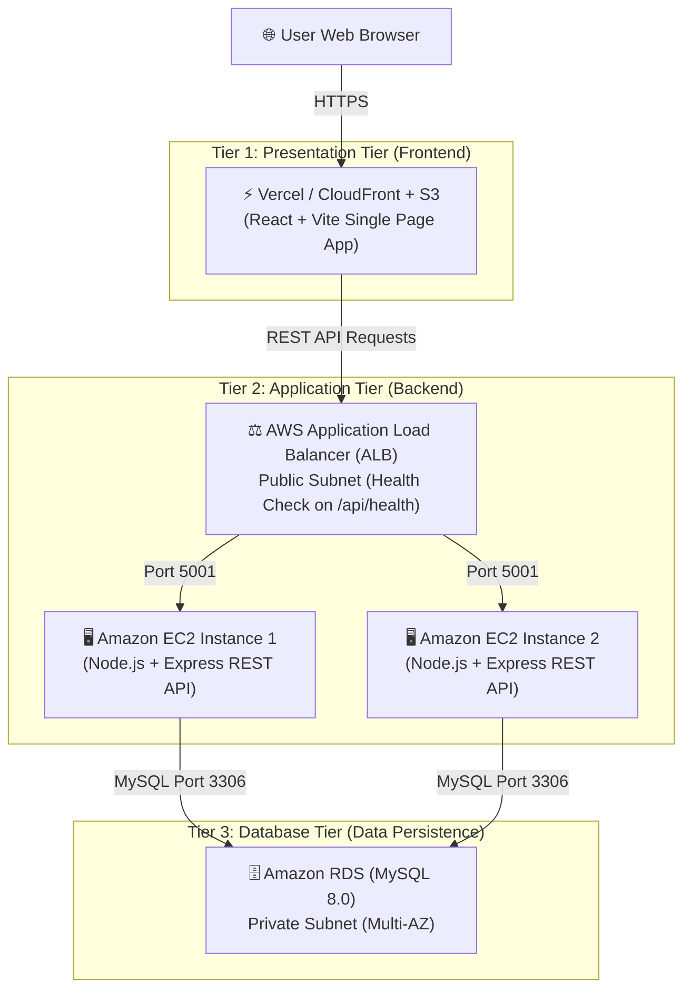

# 🛒 QuickCart - Modern E-Commerce Application

**QuickCart** is a modern, lightweight, full-stack e-commerce web application designed specifically for learning and practicing **AWS Three-Tier Architecture**.

---

## 🏛️ Architecture Overview

QuickCart is structured according to the classic **Three-Tier Architecture** pattern:



| Tier | Technology | Production AWS Hosting | Local Development |
| :--- | :--- | :--- | :--- |
| **Presentation Tier** | React 19 + Vite | **Vercel** or **AWS S3 + CloudFront** | `http://localhost:5174` |
| **Application Tier** | Node.js + Express | **Amazon EC2** behind an **ALB** | `http://localhost:5001` |
| **Database Tier** | MySQL 8.0+ | **Amazon RDS (MySQL)** | Local MySQL Server (`3306`) |

---

## ✨ Features

- **Storefront & Navigation:** Modern sticky navbar with QuickCart branding, instant search bar, and cart item counter badge.
- **Product Catalog:** 6 sample consumer electronics and lifestyle products with high-resolution imagery, category tags, star ratings, and prices in Indian Rupees (**₹**).
- **Interactive Search:** Real-time search filtering across product titles, descriptions, and categories.
- **Shopping Cart Drawer:** Smooth slide-out cart drawer with quantity adjustment (`+` / `-`), individual item removal, free delivery milestone indicator, and automatic total calculations.
- **Streamlined Checkout:** Clean modal form collecting customer Name, Email, and Delivery Address with client-side validation.
- **Relational Data Persistence:** Creates ACID-compliant transactions in MySQL for orders and line items (`orders` and `order_items` tables).
- **Order Confirmation:** Post-checkout celebratory confirmation with unique order ID, itemized breakdown, and delivery details.
- **ALB Health Check Ready:** Dedicated `GET /api/health` endpoint tailored for AWS Application Load Balancer target group health checks.

---

## 📁 Repository Structure

```
3tracr/
├── backend/                  # Node.js + Express REST API
│   ├── .env.example          # Environment variable template
│   ├── package.json          # Express, mysql2, cors, dotenv
│   ├── db/
│   │   ├── schema.sql        # MySQL table schema & sample seed data
│   │   └── initDb.js         # Automated DB migration and seeder script
│   └── src/
│       ├── config/
│       │   └── db.js         # MySQL2 connection pool & RDS SSL support
│       ├── controllers/
│       │   ├── productController.js  # Product retrieval & search
│       │   └── orderController.js    # Order transaction processing
│       ├── routes/
│       │   ├── productRoutes.js      # /api/products
│       │   └── orderRoutes.js        # /api/orders
│       └── server.js         # Express app entry & /api/health
│
├── frontend/                 # React + Vite Client
│   ├── .env.example          # Frontend environment variables template
│   ├── index.html            # HTML entry point with metadata
│   ├── vite.config.js        # Vite dev server & proxy settings
│   ├── package.json          # React, Lucide-react icons, Vite
│   └── src/
│       ├── App.jsx           # Main layout & catalog state
│       ├── index.css         # Modern light-theme vanilla CSS design system
│       ├── components/
│       │   ├── Navbar.jsx               # Brand, search bar & cart badge
│       │   ├── ProductCard.jsx          # Individual product card
│       │   ├── ProductGrid.jsx          # Catalog grid & empty states
│       │   ├── CartDrawer.jsx           # Slide-out shopping cart
│       │   ├── CheckoutModal.jsx        # Name, email & address checkout
│       │   ├── OrderConfirmationModal.jsx # Order success summary
│       │   └── Toast.jsx                # Notification toasts
│       ├── context/
│       │   └── CartContext.jsx          # Global cart state & actions
│       └── services/
│           └── api.js                   # REST client for backend
└── README.md                 # Complete documentation & AWS guide
```

---

## 🐳 Run with Docker (1-Command Setup)

QuickCart is fully containerized with **Docker Compose**, orchestrating the Frontend (Nginx), Backend (Express API), and Database (MySQL 8.0) automatically!

### Start the Entire Stack
```bash
docker compose up -d
```

### Access Your Services
| Container Service | URL | Description |
| :--- | :--- | :--- |
| **Frontend** (`quickcart-frontend`) | **http://localhost:3000** | React Single Page App served by Nginx |
| **Backend API** (`quickcart-backend`) | **http://localhost:5001** | Express REST API |
| **Health Check** | **http://localhost:5001/api/health** | ALB & Docker Health check |
| **Database** (`quickcart-db`) | `localhost:3307` (Internal `3306`) | MySQL 8.0 with pre-seeded products & tables |

### Useful Docker Commands
```bash
# View real-time logs
docker compose logs -f

# Check container health status
docker compose ps

# Stop the containers
docker compose down

# Stop and wipe database volume (to start completely fresh)
docker compose down -v
```

---

## 💻 Manual Local Setup (Without Docker)

### 1. Prerequisites
- **Node.js** (v18.0+) & **npm**
- **MySQL Server** (v8.0+) or **Amazon RDS**

### 2. Database Setup

1. Open your MySQL client (e.g. MySQL Workbench, DBeaver, or terminal):
   ```bash
   mysql -u root -p
   ```
2. Execute the schema script located in [backend/db/schema.sql](file:///home/nikhil-singh/projects/3tracr/backend/db/schema.sql):
   ```bash
   mysql -u root -p < backend/db/schema.sql
   ```
   *Alternatively, configure your `backend/.env` credentials and run:*
   ```bash
   cd backend
   npm run db:init
   ```

---

### 3. Backend Setup

1. Navigate to the `backend` directory:
   ```bash
   cd backend
   ```
2. Install dependencies:
   ```bash
   npm install
   ```
3. Create your `.env` file from the example:
   ```bash
   cp .env.example .env
   ```
4. Configure your database credentials in `backend/.env`:
   ```ini
   PORT=5001
   NODE_ENV=development
   DB_HOST=localhost
   DB_PORT=3306
   DB_USER=root
   DB_PASSWORD=your_mysql_password
   DB_NAME=quickcart_db
   DB_SSL=false
   CLIENT_URL=http://localhost:5173
   ```
5. Start the backend server:
   ```bash
   npm run dev
   # Server starts on http://localhost:5001
   ```
6. Test API health:
   ```bash
   curl http://localhost:5001/api/health
   ```

---

### 4. Frontend Setup

1. Open a new terminal and navigate to the `frontend` directory:
   ```bash
   cd frontend
   ```
2. Install dependencies:
   ```bash
   npm install
   ```
3. Create your `.env` file:
   ```bash
   cp .env.example .env
   ```
   *(For local development, `VITE_API_BASE_URL` can remain empty as Vite automatically proxies `/api` to `http://localhost:5001`)*
4. Start the Vite development server:
   ```bash
   npm run dev
   ```
5. Open your browser and navigate to:
   ```
   http://localhost:5173
   ```

---

## 📡 REST API Reference

### 1. Health Check (ALB Target Group)
- **Endpoint:** `GET /api/health`
- **Description:** Returns server uptime and database connectivity. Used by AWS ALB target groups.

### 2. User Authentication (Signup & Login)
- **Signup:** `POST /api/auth/signup`
  - **Body:** `{ "name": "Sneha Rao", "email": "sneha@example.com", "password": "mypassword123" }`
  - **Response:** Returns JWT token and user profile.
- **Login:** `POST /api/auth/login`
  - **Body:** `{ "email": "sneha@example.com", "password": "mypassword123" }`
  - **Response:** Returns JWT token and user profile.
- **Current User Profile:** `GET /api/auth/me`
  - **Headers:** `Authorization: Bearer <token>`

### 3. Get Products Catalog
- **Endpoint:** `GET /api/products`
- **Optional Query Parameter:** `?search=smartwatch`
- **Sample Response:**
  ```json
  {
    "success": true,
    "source": "database",
    "count": 6,
    "data": [
      {
        "id": 1,
        "name": "Noise ColorFit Pro 5 Smartwatch",
        "description": "1.85\" AMOLED display with Bluetooth calling, 7-day battery life...",
        "price": 2999.00,
        "image_url": "https://images.unsplash.com/...",
        "category": "Electronics",
        "stock": 45,
        "rating": 4.7
      }
    ]
  }
  ```

### 3. Place an Order
- **Endpoint:** `POST /api/orders`
- **Headers:** `Content-Type: application/json`
- **Request Body:**
  ```json
  {
    "customerName": "Nikhil Sharma",
    "customerEmail": "nikhil@example.com",
    "customerAddress": "Flat 402, Indiranagar, Bengaluru, Karnataka 560038",
    "items": [
      {
        "id": 1,
        "name": "Noise ColorFit Pro 5 Smartwatch",
        "price": 2999.00,
        "quantity": 1
      }
    ]
  }
  ```
- **Sample Response (HTTP 201 Created):**
  ```json
  {
    "success": true,
    "message": "Order placed successfully and recorded in MySQL database!",
    "data": {
      "orderId": 101,
      "customerName": "Nikhil Sharma",
      "customerEmail": "nikhil@example.com",
      "customerAddress": "Flat 402, Indiranagar, Bengaluru, Karnataka 560038",
      "totalAmount": 2999.00,
      "status": "Confirmed",
      "createdAt": "2026-10-15T04:35:10.120Z",
      "items": [...]
    }
  }
  ```

---

## ☁️ AWS Three-Tier Deployment Guide

### **Tier 3: Database Tier (Amazon RDS MySQL)**
1. **Create Subnet Group:** Create a DB Subnet Group across at least two Availability Zones in private subnets.
2. **Create MySQL RDS Instance:**
   - Engine: MySQL 8.0+
   - Template: Free tier / Dev
   - DB Instance Identifier: `quickcart-db`
   - Master username: `admin`
   - Master password: `<secure-password>`
   - Initial database name: `quickcart_db`
3. **Security Group Configuration:**
   - Inbound Rule: MySQL/Aurora (Port `3306`), Source: **Security Group of the EC2 backend instances**.

---

### **Tier 2: Application Tier (Amazon EC2 + Application Load Balancer)**
1. **Launch EC2 Instance:**
   - AMI: Ubuntu 22.04 LTS / Amazon Linux 2023
   - Instance Type: `t2.micro` or `t3.micro`
   - Security Group: Allow HTTP (Port `5001` or `80`) from the ALB Security Group.
2. **Deploy Backend on EC2:**
   ```bash
   git clone <your-repo-url>
   cd 3tracr/backend
   npm install --production
   ```
3. **Configure Environment Variables:**
   Create `.env`:
   ```ini
   PORT=5001
   NODE_ENV=production
   DB_HOST=quickcart-db.xxxxxx.us-east-1.rds.amazonaws.com
   DB_PORT=3306
   DB_USER=admin
   DB_PASSWORD=<rds-password>
   DB_NAME=quickcart_db
   DB_SSL=true
   CLIENT_URL=*
   ```
4. **Process Management (PM2):**
   ```bash
   npm install -g pm2
   pm2 start src/server.js --name "quickcart-api"
   pm2 startup
   pm2 save
   ```
5. **Configure AWS Application Load Balancer (ALB):**
   - Scheme: Internet-facing (Public Subnets).
   - Listener: HTTP `80` (or HTTPS `443`).
   - Target Group: Target Type = Instances, Protocol = HTTP, Port = `5001`.
   - **Health Check Path:** `/api/health` (Healthy threshold = 2, Interval = 30s).
   - Register your EC2 instance(s).

---

### **Tier 1: Presentation Tier (React on Vercel)**
1. Push your code to GitHub.
2. Go to [Vercel Dashboard](https://vercel.com/) and click **Add New Project**.
3. Select your repository and set the **Root Directory** to `frontend`.
4. Under **Environment Variables**, add:
   ```
   VITE_API_BASE_URL=http://<your-alb-dns-name>.amazonaws.com
   ```
   *(or your custom domain pointing to the ALB)*
5. Click **Deploy**. Vercel will build the React SPA and serve it over a global CDN.

---

## 🔒 Security Best Practices for AWS 3-Tier
- **Strict Security Group Chaining:**
  - `ALB Security Group`: Inbound Port 80/443 from `0.0.0.0/0`.
  - `EC2 Security Group`: Inbound Port 5001 only from `ALB Security Group`.
  - `RDS Security Group`: Inbound Port 3306 only from `EC2 Security Group`.
- **Database in Private Subnets:** Amazon RDS has no public IP and cannot be accessed from the public internet.
- **Environment Secrets:** Never commit `.env` files into source control.
