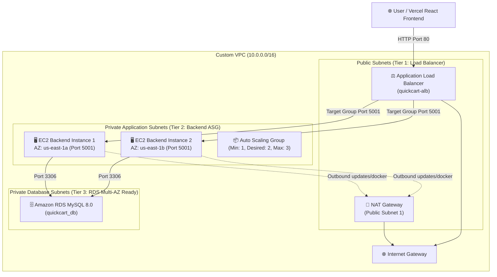

# 🚀 QuickCart AWS Three-Tier Architecture with Terraform

This directory contains the **complete, production-grade, single-file Terraform deployment** for **QuickCart** on Amazon Web Services (AWS).

It creates the entire infrastructure from scratch and deploys the QuickCart backend in Docker containers across multiple Availability Zones with Auto Scaling and Amazon RDS MySQL.

---

## 🏛️ Architecture Blueprint



---

## 📋 What Gets Created (All in `main.tf`)

| Component | AWS Resources Created | Description |
| :--- | :--- | :--- |
| **1. Networking** | `aws_vpc`<br/>`aws_subnet` (6 subnets)<br/>`aws_internet_gateway`<br/>`aws_eip` + `aws_nat_gateway`<br/>`aws_route_table` & associations | Custom VPC (`10.0.0.0/16`) spanning **2 Availability Zones** with 2 Public Subnets, 2 Private App Subnets, and 2 Private DB Subnets. |
| **2. Security Groups** | `alb_sg`<br/>`app_sg`<br/>`db_sg` | **Strict Security Chaining:**<br/>• ALB accepts port 80 from `0.0.0.0/0`<br/>• App EC2 accepts port 5001 **only from ALB SG**<br/>• RDS MySQL accepts port 3306 **only from App SG** |
| **3. Database Tier** | `aws_db_subnet_group`<br/>`aws_db_instance` | Amazon RDS MySQL 8.0 (`db.t3.micro`, 20GB gp3) isolated in private database subnets with no public access. |
| **4. IAM & SSM** | `aws_iam_role`<br/>`aws_iam_instance_profile` | Allows connecting to private EC2 instances securely via **AWS Systems Manager (SSM) Session Manager** without SSH keys or open port 22. |
| **5. Application Tier** | `aws_lb`<br/>`aws_lb_target_group`<br/>`aws_lb_listener`<br/>`aws_launch_template`<br/>`aws_autoscaling_group` | Public ALB with `/api/health` health checks, Launch Template with automated cloud-init user data, and Multi-AZ Auto Scaling Group. |
| **6. Docker Deployment** | Cloud-init User Data script | On boot, private EC2 instances install Docker, wait for RDS MySQL, auto-seed the database schema, and launch the QuickCart backend container on port 5001. |

---

## ⚡ Deployment Instructions

### Step 1: Configure AWS CLI Credentials
Ensure you have the AWS CLI configured with permissions to create VPC, EC2, ALB, and RDS resources:
```bash
aws configure
```

### Step 2: Set Your Variables
Navigate to the `terraform` directory:
```bash
cd terraform
cp terraform.tfvars.example terraform.tfvars
```
Edit `terraform.tfvars` with your preferred database password:
```ini
aws_region   = "us-east-1"
db_password  = "YourSecurePassword123!"
```

### Step 3: Initialize Terraform
```bash
terraform init
```

### Step 4: Preview the Execution Plan
Review the resources that will be provisioned:
```bash
terraform plan
```

### Step 5: Provision Infrastructure
Deploy the complete three-tier architecture:
```bash
terraform apply
```
*(Enter `yes` when prompted. RDS creation typically takes 4–8 minutes).*

---

## 🎯 Verification & Outputs

Once `terraform apply` finishes, Terraform will output your live URLs:

```
Outputs:
alb_dns_name           = "quickcart-alb-123456789.us-east-1.elb.amazonaws.com"
alb_url                = "http://quickcart-alb-123456789.us-east-1.elb.amazonaws.com"
health_check_url       = "http://quickcart-alb-123456789.us-east-1.elb.amazonaws.com/api/health"
products_api_url       = "http://quickcart-alb-123456789.us-east-1.elb.amazonaws.com/api/products"
rds_endpoint           = "quickcart-mysql.cxxxxxx.us-east-1.rds.amazonaws.com:3306"
vercel_frontend_config = "VITE_API_BASE_URL=http://quickcart-alb-123456789.us-east-1.elb.amazonaws.com"
```

### Test the Endpoints:
```bash
# 1. Test ALB Target Group Health Check
curl http://<YOUR_ALB_DNS>/api/health

# 2. Test Product Catalog
curl http://<YOUR_ALB_DNS>/api/products
```

---

## 🌐 Connecting Vercel Frontend

To connect your React frontend on Vercel:
1. Go to your **Vercel Project Dashboard** -> **Settings** -> **Environment Variables**.
2. Add:
   ```
   VITE_API_BASE_URL = http://<YOUR_ALB_DNS>
   ```
3. Redeploy the frontend. All product browsing, login, signup, cart actions, and orders will communicate with your AWS EC2 instances and persist in Amazon RDS!

---

## 🧹 Teardown (Avoid AWS Costs)

When you are done practicing your three-tier architecture:
```bash
terraform destroy
```
*(Enter `yes` when prompted. All 30+ resources including NAT Gateway, ALB, EC2, and RDS will be cleanly deleted).*
